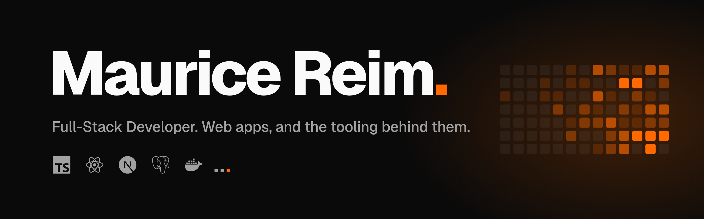

  <picture>
    <source media="(prefers-color-scheme: dark)" srcset="assets/banner-dark.png">
    <source media="(prefers-color-scheme: light)" srcset="assets/banner-light.png">
    
  </picture>

Hi, I'm Maurice.

I'm a full-stack developer at [Interaktiv GmbH](https://www.interaktiv.de/) in Kerpen, Germany, currently in my apprenticeship. At work I build websites and web apps with Plone and Volto.

Most of what I build are modern web and mobile apps, usually with React, Next.js, TypeScript and Expo / React Native.

### Open source

- [**formdef**](https://github.com/maurice-rm/formdef) — Describe a form once as a typed config and render it as a React component. Built on TanStack Form.
